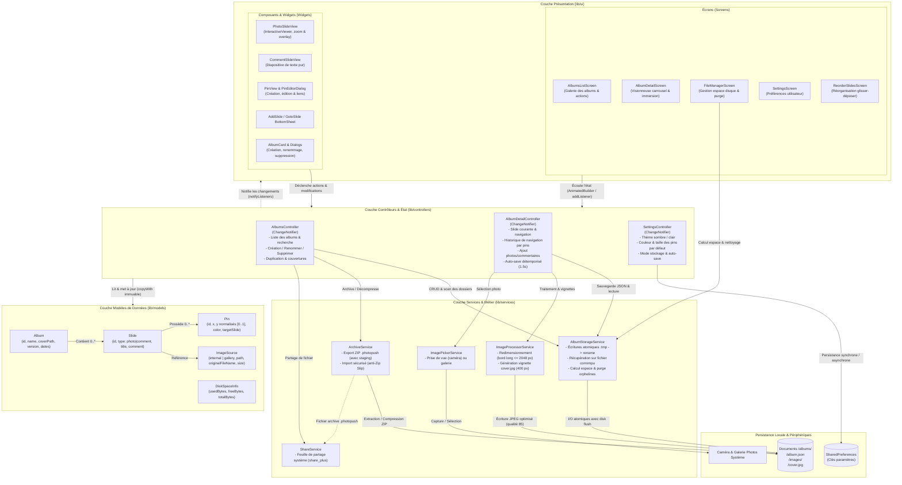
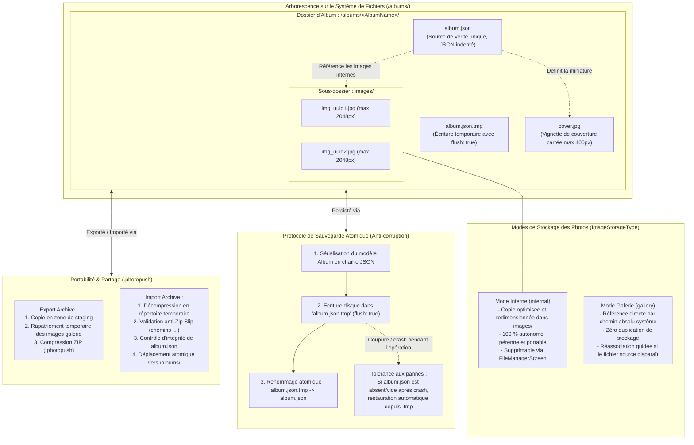
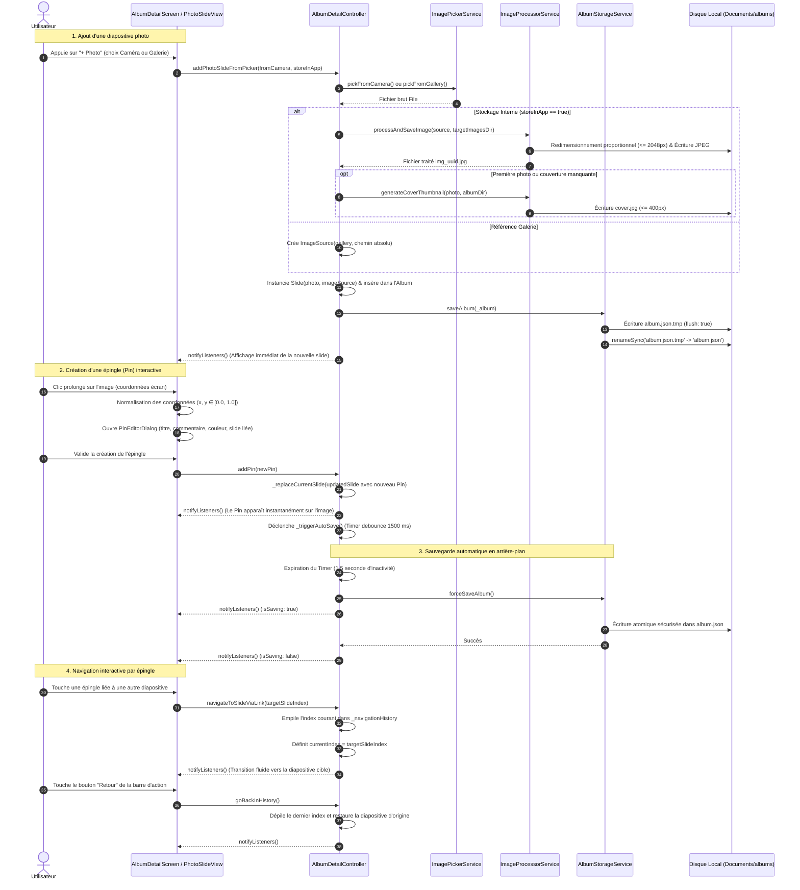

# PhotoPush

Réécriture Flutter d'une application d'albums photo interactifs, légère et 100 % hors ligne, avec import/export manuel et synchronisation distante optionnelle.

---

## Architecture logicielle

L'application repose sur une **architecture réactive en couches** (séparation Présentation / Contrôleurs / Modèles / Services) conçue selon un paradigme **100 % hors ligne (*offline-first*)** :
- **Aucune base de données SQL** : chaque album est un dossier autonome sur le système de fichiers.
- **Source de vérité unique** : le fichier `album.json` stocké dans chaque dossier d'album.
- **Gestion d'état réactive** : utilisation de `ChangeNotifier` (`ListenableBuilder` / `AnimatedBuilder`) sans surcoût de frameworks tiers.
- **Modèles immuables** : sérialisation JSON stricte et méthodes `copyWith`.
- **Résilience aux pannes** : écritures atomiques sur disque et récupération automatique en cas de crash.

```
lib/
├── controllers/    # Gestion d'état & orchestration métier (ChangeNotifier)
├── models/         # Modèles de domaine immuables & sérialisation JSON
├── services/       # E/S, persistance atomique, traitement d'images & archives
│   ├── media/      # Traitement image, sélection (picker), partage système
│   └── storage/    # Gestion du système de fichiers & archives .photopush
└── ui/             # Couche présentation Flutter (écrans & widgets)
    ├── screens/    # Écrans principaux (liste, détail/slides, réorganisation, paramètres)
    └── widgets/    # Vues de diapositives, overlay de pins, dialogues et panneaux
```

---

### 1. Communication entre les composants

Le diagramme ci-dessous illustre les interactions et flux de communication entre la vue (UI), les contrôleurs d'état, les modèles de données et les services d'infrastructure :



---

### 2. Gestion des données et persistance sur disque

Chaque album est entièrement encapsulé dans un sous-répertoire sous le dossier des documents de l'application (`<app_documents>/albums/<AlbumName>/`).



---

### 3. Flux de données et cycle de vie des interactions

Ce diagramme de séquence détaille le cycle complet lors de l'ajout d'une photo, du placement d'une épingle (*pin*) interactive et de la sauvegarde automatique détemporisée (*debounced auto-save*) :



---

## Documentation

- [Cahier des charges v1.1 (`doc/cdc2.typ`)](doc/cdc2.typ)
- [Spécifications fonctionnelles & Backlog Agile User Stories (`doc/USER_STORIES.md`)](doc/USER_STORIES.md)

## Développement

Le projet est configuré avec un environnement Nix (`flake.nix` et `direnv`) fournissant Flutter, Dart et le SDK Android.

```bash
# Vérification du code
flutter analyze

# Formatage
dart format .

# Tests unitaires et d'intégration
flutter test

# Lancer l'application
flutter run
```
